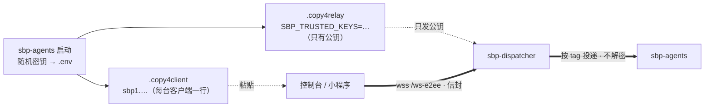

# sbp-console —— 一个页面看 N 台服务器

每台机器跑 `sbp-server`（面板用 `--bridge` 把本机会话上报上去），这个页面只保存
「服务器地址 + 鉴权」的列表，左上角下拉切机器。两个网址变一个网址。

```
┌──────────────┐        ┌──────────────────┐        ┌──────────────┐
│ 机器 A 面板  │─bridge─│  机器 A sbp-server│◀──wss──│              │
└──────────────┘        └──────────────────┘        │  sbp-console │
┌──────────────┐        ┌──────────────────┐        │   （一个页面）│
│ 机器 B 面板  │─bridge─│  机器 B sbp-server│◀──wss──│              │
└──────────────┘        └──────────────────┘        └──────────────┘
       面板只往外连，机器不需要对外开放任何额外端口
```

## 跑起来

没有构建步骤，三个文件丢到任意静态目录即可：

```bash
# 1) 直接本地打开（file:// 也能跑，WebSocket 不受同源限制）
open index.html

# 2) 或挂到 nginx 某个子路径下
#    location /sbp-console/ { alias /path/to/sbp-console/; index index.html; }
```

## 最省事的一条路：粘贴导入（E2EE）

机器上装了 [`sbp-agents`](https://pypi.org/project/sbp-agents/) 的话，启动后它会把连接信息
写到 `.copy4client` 并在终端打印出来：

```bash
cat .copy4client        # 整段复制
```

粘进控制台 ⚙ → **粘贴导入** 框 → 点「导入」，一次导入两台客户端（网页控制台 + 微信小程序），
每台自带私钥 —— DID / rk / 公钥都不用手填。中继那边用 `cat .copy4relay` 那行
`SBP_TRUSTED_KEYS=` 启动，整条链路就是端到端加密的：中继只看到 `tag` + 密文，
解不开 prompt，也看不出这个 tag 对应哪个会话。



## 加一台服务器（手工填）

点左上角 ⚙ → ＋新增：

| 字段 | 说明 |
|---|---|
| 名称 | 只是显示用，写「ECS」「GPU 家机」都行 |
| 地址 | `wss://host:8787` / `https://host/sbp-ecs` / `host:8787/ws`，缺的路径自动补 `/ws` |
| 鉴权 | **HMAC**（推荐）/ Token / Bearer / 无 |
| keyId + secret | 服务端 `SBP_HMAC_KEYS` 里配的那对 |

「测试连接」会真的握手并拉一次会话列表，返回「设备 N 台 · 会话 M 个」才算通。

勾上 **E2EE（端到端加密）** 后地址会改写为 `/ws-e2ee`，需要填：设备 DID、路由密钥 rk、
对端 keyId / box 公钥 / sign 公钥、本机 keyId。本机私钥存 localStorage，永不上传。

配置存在浏览器 localStorage 里。点「复制配置链接」会生成一条带 `?cfg=` 的链接，
在手机/另一台电脑打开即可导入同一份配置（**链接里含密钥，别乱发**）。

## 服务端要做的两件事

**1. sbp-server 开 HMAC**（每台机器一对 keyId/secret）：

```bash
SBP_HMAC_KEYS=ecs:你的secret SBP_HOST=127.0.0.1 SBP_PORT=8787 python -m sbp_server.app
```

systemd 就一行：

```ini
[Service]
Environment=SBP_HMAC_KEYS=ecs:你的secret
```

**2. 面板上报**（同一台机器上）：

```bash
python -m tmux_panel --bridge ws://127.0.0.1:8787/ws    # 或环境变量 SBP_BRIDGE
```

面板随即在 sbp-server 上注册成一台 device，把本机 tmux / Claude / Qwen Code 会话
报上去。客户端连的是 **服务器**，不是面板，所以面板自己的端口不用对外开放。

## nginx：把 ws 暴露出去

```nginx
# 云机本机
location /sbp-ecs/ {
    proxy_pass http://127.0.0.1:8787/;
    proxy_http_version 1.1;
    proxy_set_header Upgrade $http_upgrade;
    proxy_set_header Connection $connection_upgrade;
    proxy_read_timeout 3600s; proxy_send_timeout 3600s;
    proxy_buffering off;
}
# 隧道另一头的机器：复用已有 frp 隧道，只换路径
location /sbp-gpu/ { proxy_pass http://127.0.0.1:20050/sbp-gpu/; ... }
```

⚠️ `location` 与请求的路径都要带末尾斜杠：客户端访问的是 `/sbp-ecs/ws`，
少了斜杠 nginx 会回 301，而 WebSocket 握手吃不下 301（表现就是一直重连）。

## 协议上用到了什么

| 帧 | 用途 |
|---|---|
| `hello`（带 `auth` 签名） | 握手；服务端据此给出「server 级」还是「设备级」scope |
| `session.list` | 会话列表，按设备分组，每项带 `did` |
| `session.attach` / `detach` | 订阅某个会话的屏幕与提示 |
| `session.history` | 倒序翻历史（`before` = 上一页最早的 seq） |
| `output.delta` | 实时屏幕 |
| `session.prompt` / `session.answer` | SBP-0.2 选项卡：终端上的选项变成按钮 |
| `session.input` | 发指令 / 按键 |
| `device.state` | 设备上下线，页面据此重拉列表 |

server 级客户端（HMAC 进来）拿到的 `did` 是 `*`，能看到这台服务器上登记的全部
设备；请求里的 `sid` 由服务端反查归属设备再转发，客户端不用维护 sid→设备 的映射。
